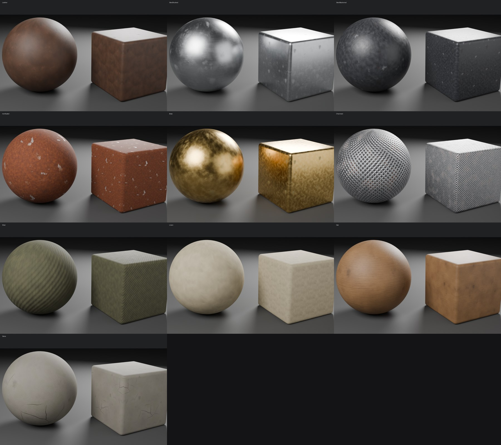

# aaa-materials

Claude Code plugin + Python toolkit for AAA-quality PBR textures and materials,
built on headless Blender (`pip install bpy`) and aimed at Unreal Engine 5.



| Part | What it does |
|---|---|
| `lib/aaa_materials/library.py` | Smart materials with built-in wear/dirt: `leather`, `steel` (polished/brushed/forged), `steel_blackened`, `iron_rusted`, `precious_metal` (brass/bronze/gold/silver/copper), `chainmail`, `wool` (quilted), `linen`, `wood` (oak/ash/walnut/pine), `stone` |
| `lib/aaa_materials/weathering.py` | Edge wear, cavity dirt, dust, stains, scratches, creases, pits, breakup masks |
| `lib/aaa_materials/engine.py` | Node-graph helper and bake pipeline: geometry masks, BaseColor / ORM / Normal (DirectX + OpenGL) / Height, seamless tiling |
| `lib/aaa_materials/validate.py` | PBR checks: albedo ranges, metal reflectance, metallic purity, roughness variation, normal validity, AO, tiling |
| `lib/aaa_materials/lookdev.py` | Material-ball renders and contact sheets |
| `lib/aaa_materials/unreal.py` | Writes an Unreal import script: textures + shared `M_AAA_Master` + `MI_<Name>` |
| `scripts/aaa.py` | CLI: `presets`, `tile`, `validate`, `ball`, `unreal`, `sheet` |
| `skills/aaa-materials/` | The Claude skill (workflow + AAA quality bar + PBR reference numbers) |

## Install

- **Claude Code on the web / cloud sessions in this repo**: nothing to do. The project skill
  `.claude/skills/aaa-materials` loads automatically and points at this folder.
- **Claude Code on your PC**: open the repo; `.claude/settings.json` offers the
  `metahuman-tools` marketplace and enables `aaa-materials` (accept the trust prompt).
  Or by hand: `/plugin marketplace add southwesternprod-afk/Meta-human-unreall-rpoject`
  then `/plugin install aaa-materials@metahuman-tools`.
- **Python deps**: `pip install bpy==5.2.* numpy pillow` (Python 3.13). Linux also needs
  `libopengl0`.

## Quick start

```bash
python3 plugins/aaa-materials/scripts/aaa.py presets
python3 plugins/aaa-materials/scripts/aaa.py tile --preset leather --name LeatherBrown \
    --size 0.5 --res 2048 --param color=#3b2618 --param wear=0.6 --out Art/Materials/LeatherBrown
python3 plugins/aaa-materials/scripts/aaa.py validate Art/Materials/LeatherBrown --tileable
```
Then in Unreal: File > Execute Python Script > `Art/Materials/LeatherBrown/Import_LeatherBrown_Unreal.py`
and drag `MI_LeatherBrown` onto a mesh.
